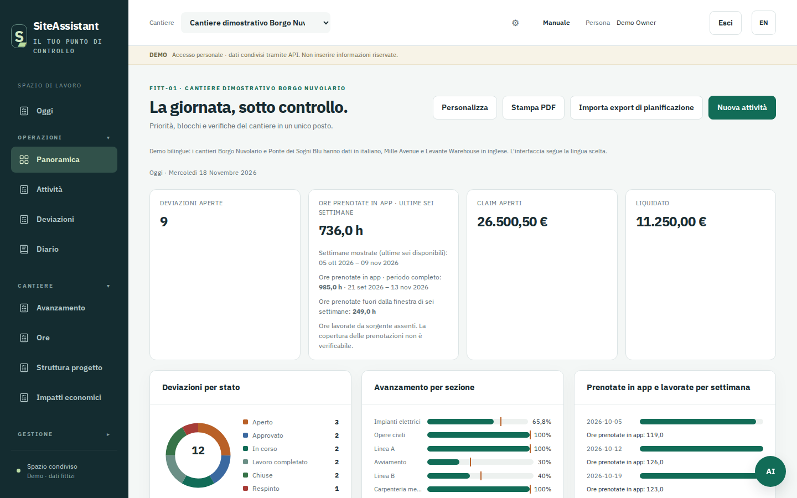

# SiteAssistant

**Built on site. For people working on site.**



SiteAssistant is a web app for the person running a construction or installation site. It keeps in one place what usually lives in five: the work to execute and to verify, the daily diary, the work breakdown structure, attendance, progress, deviations and hours.

It is not an ERP. It is the layer between the plan and what actually happens on site.

It comes from direct experience managing industrial and intralogistics sites, where checks, evidence and reporting end up split across spreadsheets, e-mails and systems that do not talk to each other.

## Who it is for

Site managers, installation managers, supervisors and verifiers working in industrial automation and intralogistics: people who have to chase contractors, prove that work was done, and reconstruct why a date slipped.

## What is inside

**Operations**
Sites and per-site roles (`owner`, `editor`, `verifier`, `viewer`) · Tasks with a separate executor and verifier, state transitions with notes and full history, ordinary or corrective type · Light task view with a single close/reopen command · Site diary by operational day and shift · Photos and PDFs attached to tasks and diary entries · Saved views: personal or shared filters, order and visible columns

**Planning**
WBS tree and flat table · Site progress with weighted steps that must sum to 100 · Planned hours per item, inherited from the linked WBS node when absent · Earned value — EV, PV, AC, CPI and SPI in hours · Progress curves from recorded entries

**Control**
Deviations with links and a read-only reconciliation panel for inconsistent chronologies · Cost impacts · Time bookings, separating hours worked, booked at source and booked in the app, with a signed variance · Printable site report with progress and deviations per macro-area, plus CSV export

**Compliance**
Tools register per contractor, with status and location · Employee fitness: certifications, medical visits and training, with expiry and computed status · HSE register: near misses, injuries and observations, with severity, location and a count of people involved — no names, no health data

**Administration**
E-mail and password sessions, self-service sign-up with owner approval, password reset · Per-module access per member, independent of role · Import of planning exports with preview, confirmation and per-site column mapping · REST API with pagination and per-user rate limits · Read-only data assistant with record citations

**Field use**
Installable PWA, Italian and English interface, mobile bottom navigation, sortable tables, optional column filters · Tasks and diary work offline: writes are queued and synchronised when the network returns

## What it is not

- **Not an ERP, not a planning system.** It stays complementary to time schedules, purchasing and accounting, and does not try to replace them.
- **Not a copy of another product.** The application code was written for this project and contains no third-party source code. Its functional model was informed by the author's professional experience with construction site management and by the public behaviour of comparable tools. SiteAssistant is an independent project, not affiliated with, endorsed by, or supplied by any vendor.
- **Not finished.** The [product status](https://as76.github.io/SiteAssistant/note/rilascio/) page lists what exists only via API and what does not exist yet. It is deliberately explicit.

## Status

Running on synthetic demo data. It is a working demo, not a product: do not put confidential data, credentials or contract terms into it.

Known gaps that matter before real use: imported rows are updated by re-import and only planned hours can be edited by hand; there is no PDF generation on the server (printing goes through the browser); and there is no connector to ERP or planning systems. HSE, certification, tool and inspection records keep an audit trail (#52), and deviations keep an append-only status history with provenance (#50).

## Run it locally

Node.js 24. SQLite is the default driver, no external database needed:

```sh
npm ci
npm run seed        # 4 fictional users and 2 sites
npm run seed:demo   # synthetic WBS, tasks, hours, deviations, HSE, tools
node server/seed-northline.mjs --apply   # two pilot sites, NL-IT-01 and NL-UK-01
npm run dev         # API and interface on http://localhost:8787
```

`npm start` runs the API alone, which is what production does behind the reverse proxy. `npm run dev` also serves `app/` from the same origin, so the interface works without any proxy or CORS exception.

Demo account: `owner@example.invalid`, password `Local-owner-5b!` (fictional, seeded only outside production). For PostgreSQL set `DB_DRIVER=pg` and `DATABASE_URL`.

The pilot dataset in `server/seed-northline.mjs` creates two synthetic sister sites, `NL-IT-01` (Italian content) and `NL-UK-01` (English content), with tasks, diary, attendance, progress, deviations, HSE, fitness, tools and logistics. It is idempotent; `--reset` removes only those two sites. Set `NORTHLINE_SEED_PASSWORD` before the first `--apply` to give the seven pilot accounts a known password; otherwise each receives a random password that is never printed. The CLI refuses `NODE_ENV=production`.

The interface is a static app in `app/`. It is meant to be served from the **same origin** as the API: `npm run dev` does that locally, the reverse proxy does it in production. The API answers CORS requests only from the published origin, so a UI served from a different port is refused; if you need one, point the app at another API with `<meta name="siteassistant-api-base" content="…">` in `app/index.html` and serve both from one host.

Full configuration is read from the environment: `PORT`, `DATA_DIR`, `DB_DRIVER`, `DATABASE_URL`, `PUBLIC_URL`, `OWNER_EMAIL`.

`AUTH_BYPASS_USER` optionally names an existing, enabled user's email. Requests without a valid session use that profile, with its current permissions; valid sessions take precedence. Unset, empty, unknown or disabled accounts grant no bypass access. All `/api/auth/*` routes retain normal authentication, including `/api/auth/me`, so the existing browser login screen is unchanged. No session or cookie is created. Restart the server after changing this variable.

`GET /api/health` includes `auth_bypass`, indicating whether a non-empty bypass email is configured (not whether that account exists or is enabled). Each bypass increments an in-memory counter per server. The first bypass and subsequent bypasses at least one minute after the previous log emit one `AUTH_BYPASS` JSON warning with method, path without query parameters and cumulative count.

## Tests

```sh
npm ci
npm test              # SQLite and PostgreSQL suites
npm run test:schema
node tests/browser.cjs # optional, needs Playwright and Chromium
```

The suite currently runs 734 tests, 730 passing and 4 skipped, in about two and a half minutes. The same suite runs on every push and pull request through GitHub Actions, against SQLite and against a real PostgreSQL service, and `main` requires both checks to be green.

## Documentation

- User manual, Italian and English: <https://as76.github.io/SiteAssistant/>
- REST API reference: <https://as76.github.io/SiteAssistant/riferimento/api/>
- Product status and known limits: <https://as76.github.io/SiteAssistant/note/rilascio/>

## Contributing

Contributing is not only writing code: a well-described report or a proposal about a real site workflow is worth as much as a pull request. Read [CONTRIBUTING.md](CONTRIBUTING.md) and open an [issue](https://github.com/AS76/SiteAssistant/issues).

## License

**GNU Affero General Public License v3.0** (`AGPL-3.0-only`). If you modify SiteAssistant and make it available over a network, you must publish the modified source under the same terms. Full text in [LICENSE](LICENSE).
