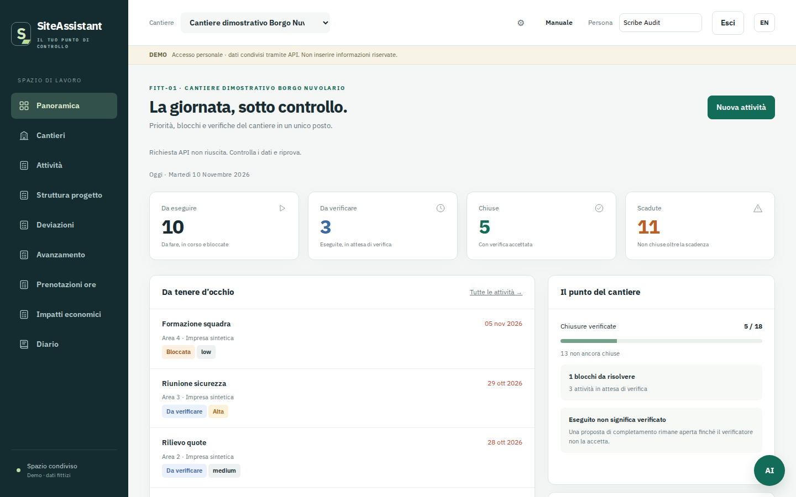

# SiteAssistant

**Built on site. For people working on site.**



SiteAssistant is a web app for the person running a construction or installation site. It keeps in one place what usually lives in five: the work to execute and to verify, the daily diary, the work breakdown structure, attendance, progress, deviations and hours.

It is not an ERP. It is the layer between the plan and what actually happens on site.

It comes from direct experience managing industrial and intralogistics sites, where checks, evidence and reporting end up split across spreadsheets, e-mails and systems that do not talk to each other.

## Who it is for

Site managers, installation managers, supervisors and verifiers working in industrial automation and intralogistics: people who have to chase contractors, prove that work was done, and reconstruct why a date slipped.

## What is inside

**Operations**
Sites and per-site roles (`owner`, `editor`, `verifier`, `viewer`) · Tasks with a separate executor and verifier, state transitions with notes and full history, ordinary or corrective type · Light task view with a single close/reopen command · Site diary by operational day and shift · Photos and PDFs attached to tasks and diary entries · Saved views: personal or shared filters, order and visible columns

**Planning**
WBS tree and flat table · Site progress with weighted steps that must sum to 100 · Planned hours per item, inherited from the linked WBS node when absent · Earned value — EV, PV, AC, CPI and SPI in hours · Progress curves from recorded entries

**Control**
Deviations with links and a read-only reconciliation panel for inconsistent chronologies · Cost impacts · Time bookings, separating hours worked, booked at source and booked in the app, with a signed variance · Printable site report with progress and deviations per macro-area, plus CSV export

**Compliance**
Tools register per contractor, with status and location · Employee fitness: certifications, medical visits and training, with expiry and computed status · HSE register: near misses, injuries and observations, with severity, location and a count of people involved — no names, no health data

**Administration**
E-mail and password sessions, self-service sign-up with owner approval, password reset · Per-module access per member, independent of role · Import of planning exports with preview, confirmation and per-site column mapping · REST API with pagination and per-user rate limits · Read-only data assistant with record citations

**Field use**
Installable PWA, Italian and English interface, mobile bottom navigation, sortable tables, optional column filters · Tasks and diary work offline: writes are queued and synchronised when the network returns

## What it is not

- **Not an ERP, not a planning system.** It stays complementary to time schedules, purchasing and accounting, and does not try to replace them.
- **Not a copy of another product.** The code is original and written from scratch. SiteAssistant is an independent project, not affiliated with or endorsed by any vendor.
- **Not finished.** The [product status](https://as76.github.io/SiteAssistant/note/rilascio/) page lists what exists only via API and what does not exist yet. It is deliberately explicit.

## Status

Running on synthetic demo data. It is a working demo, not a product: do not put confidential data, credentials or contract terms into it.

Known gaps that matter before real use: HSE, certification and tool records have no change history (deletes are immediate and leave no copy); imported data is read-only; there is no PDF generation on the server (printing goes through the browser); and there is no connector to ERP or planning systems.

## Run it locally

Node.js 24. SQLite is the default driver, no external database needed:

```sh
npm ci
npm run seed        # 4 fictional users and 2 sites
npm run seed:demo   # synthetic WBS, tasks, hours, deviations, HSE, tools
npm start           # API on http://localhost:8787
```

Demo account: `owner@example.invalid`, password `Local-owner-5b!` (fictional, seeded only outside production). For PostgreSQL set `DB_DRIVER=pg` and `DATABASE_URL`.

The interface is a static app in `app/`. It must be served from the **same origin** as the API, or point it at another API by adding `<meta name="siteassistant-api-base" content="…">` before the module script in `app/index.html`. The API answers CORS requests only from the published origin, so a UI served on another local port is blocked: use a reverse proxy on the same origin, or `content="/"` behind the same host.

Full configuration is read from the environment: `PORT`, `DATA_DIR`, `DB_DRIVER`, `DATABASE_URL`, `PUBLIC_URL`, `OWNER_EMAIL`.

## Tests

```sh
npm ci
npm test              # SQLite and PostgreSQL suites
npm run test:schema
node tests/browser.cjs # optional, needs Playwright and Chromium
```

The suite currently runs 733 tests, 729 passing and 4 skipped, in about two and a half minutes.

## Documentation

- User manual, Italian and English: <https://as76.github.io/SiteAssistant/>
- REST API reference: <https://as76.github.io/SiteAssistant/riferimento/api/>
- Product status and known limits: <https://as76.github.io/SiteAssistant/note/rilascio/>

## Contributing

Contributing is not only writing code: a well-described report or a proposal about a real site workflow is worth as much as a pull request. Read [CONTRIBUTING.md](CONTRIBUTING.md) and open an [issue](https://github.com/AS76/SiteAssistant/issues).

## License

**GNU Affero General Public License v3.0** (`AGPL-3.0-only`). If you modify SiteAssistant and make it available over a network, you must publish the modified source under the same terms. Full text in [LICENSE](LICENSE).
