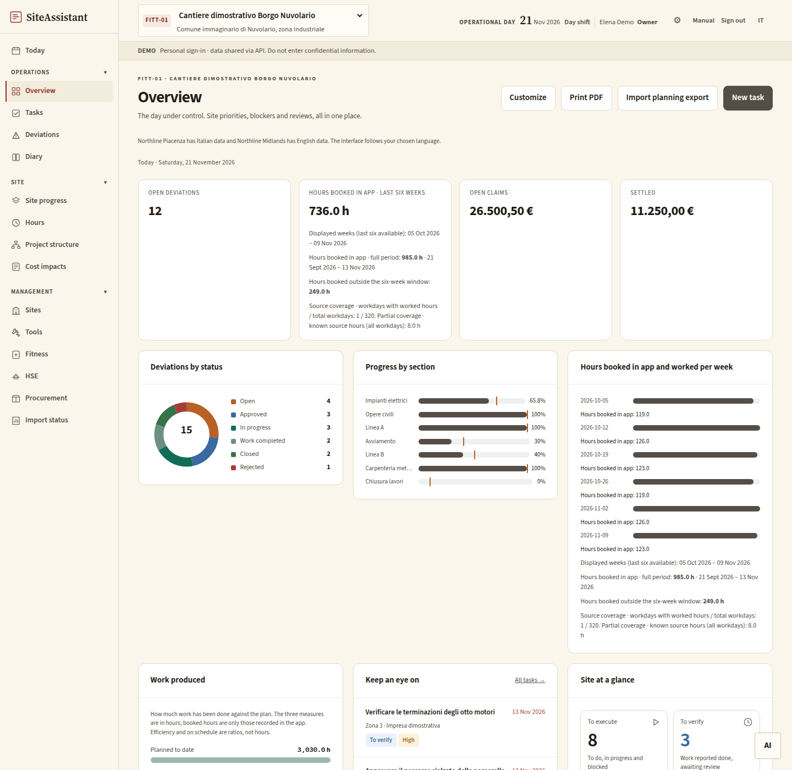
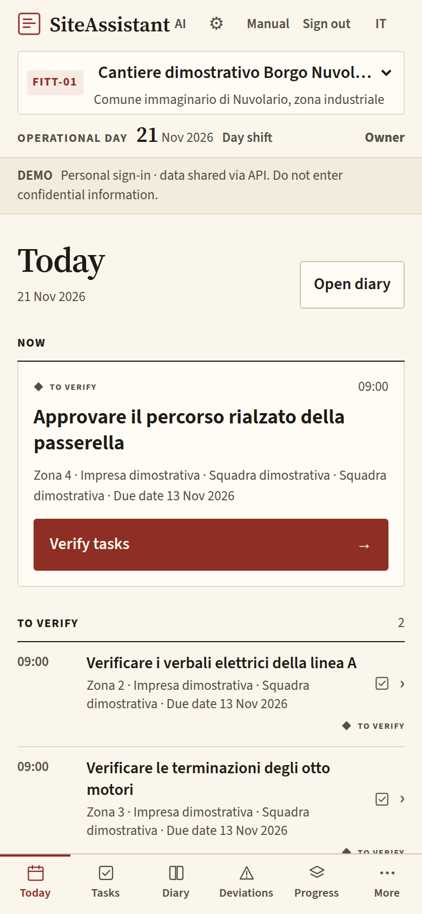

# SiteAssistant

**Built on site. For people working on site.**

SiteAssistant is an open-source web application for people managing industrial installation and intralogistics sites. It brings tasks and independent verification, the daily site diary, project structure, progress, deviations, hours, safety records and reporting into one operational workspace.

It is **not an ERP or a replacement for project scheduling software**. It connects the plan to what actually happens on site.



**[Demo access guide](https://as76.github.io/SiteAssistant/en/guida/accesso/)** · **[English user manual](https://as76.github.io/SiteAssistant/en/)** · **[Manuale italiano](https://as76.github.io/SiteAssistant/)** · **[Report an issue](https://github.com/AS76/SiteAssistant/issues)**

## Why SiteAssistant exists

On industrial sites, information is often scattered: schedules in one system, contractor hours in spreadsheets, deviations in email, and evidence across different files and applications. The person coordinating the site must reconstruct what was planned, what actually happened, who was responsible, and what has been verified.

SiteAssistant comes from direct experience managing industrial automation and intralogistics sites. Its purpose is to make daily work **easier to coordinate, verify and reconstruct**, without pretending to replace engineering, purchasing, accounting or enterprise planning systems.

## Who it is for

- **Site Managers and Installation Managers:** coordinate contractors, priorities and site execution.
- **Supervisors and Team Leaders:** follow work, capture updates and identify blockers.
- **Verifiers and commissioning personnel:** check completed activities and preserve traceability.
- **Project and Operations Managers:** review progress, delays and exceptions.
- **Site administrators and authorised contractors:** work within the roles and modules assigned to them.

The primary focus is industrial automation and intralogistics, although some workflows may apply to other installation environments.

## Try the live demo

**[Read the demo access guide](https://as76.github.io/SiteAssistant/en/guida/accesso/)**

The hosted demo address is shared separately with evaluators; it is intentionally not stored in this repository. The hosted application uses **fictional operational data**, including two Northline pilot sites:

| Site | Demonstration scenario | Record language |
| --- | --- | --- |
| `NL-IT-01` | Northline Piacenza — intralogistics plant | Italian |
| `NL-UK-01` | Northline Midlands — intralogistics installation | English |

The interface can be switched between Italian and English independently of the language of imported or entered records.

### Request access

The public demo does not provide unrestricted, immediate account creation.

1. Open the demo address provided to you; the [demo access guide](https://as76.github.io/SiteAssistant/en/guida/accesso/) explains sign-in and account requests.
2. Select **Request access** on the sign-in screen and enter your email address.
3. An administrator reviews the request and may approve or reject it.
4. If approved, you receive a temporary password by email.
5. Sign in and change that password.

**Account approval and site access are separate steps.** Approval creates an account; a site owner must also assign a membership and role before that account can see a particular site. You may therefore be able to sign in without seeing demonstration sites. Access requests are not guaranteed to be approved.

For password recovery, passkeys and sessions, see **[Sign in and account](https://as76.github.io/SiteAssistant/en/guida/accesso/)**.

### Demo data and privacy

Site records, people, companies and documents in the demonstration datasets are synthetic. However, the hosted service may process **real account, access-request, session and security-log data**; those are distinct from the fictional site records.

**Do not put real project information, confidential documents, personal or health records, contractual terms, or third-party credentials into the demo.** It is for evaluation and feedback, not production operations. See [Demo data](https://as76.github.io/SiteAssistant/en/guida/dati-dimostrativi/) and the applicable service privacy information.

## What is inside

Features are subject to the selected site's roles, module permissions and deployment configuration.

### Operations

| Area | Current capabilities |
| --- | --- |
| **Sites and access** | Site-specific memberships and roles (`owner`, `editor`, `verifier`, `viewer`); per-member module access |
| **Tasks and verification** | Executor and verifier kept separate; ordinary or corrective tasks; status transitions, notes and history |
| **Light tasks** | Simplified ordinary-task view with close/reopen actions |
| **Site diary** | Daily plan, actual work, impediments and next steps by operational day and shift |
| **Evidence** | Images and PDFs attached to supported tasks, diary entries, deviations and HSE events |
| **Views** | Personal or shared saved filters, sorting and visible columns |

### Planning and progress

| Area | Current capabilities |
| --- | --- |
| **WBS** | Hierarchical tree and flat table; operational edits with source provenance and reconciliation |
| **Site progress** | Weighted completion steps and recorded progress; planned hours at item or linked-WBS level |
| **Earned value** | EV, PV, AC, CPI and SPI expressed in hours |
| **Progress views** | Curves and indicators derived from recorded site data |

### Monitoring and control

| Area | Current capabilities |
| --- | --- |
| **Deviations** | Status, history, links and read-only checks for inconsistent source chronologies |
| **Time bookings** | Worked, source-booked and app-booked hours with signed variance |
| **Cost impacts** | Monitoring of cost effects and supported status/closure actions |
| **Reports** | Printable site summary with progress and deviations; CSV exports |
| **Import status** | Read-only summary of source bundles and quality issues, when the reporting service is configured |

### Safety, people and equipment

| Area | Current capabilities |
| --- | --- |
| **HSE** | Near misses, accidents, observations, severity, location, measures and number of people involved |
| **Fitness** | Training, certifications and medical-check validity, expiry and computed status |
| **Tools** | Contractor equipment register with status and location |
| **Audit trail** | Change history and logical deletion for supported records |

The HSE register's structured fields are not designed to collect names or medical diagnoses. **Free text and attachments can still contain sensitive information if users provide it.** SiteAssistant does not replace statutory HSE procedures, formal certification systems or professional judgement.

### Procurement and administration

- **Procurement:** purchase orders, line items, packages, shipments and receipts; the module is optional and access-controlled.
- **Authentication:** email/password sessions, optional WebAuthn passkeys, administrator-approved access requests and password recovery.
- **Imports:** planning exports with preview, confirmation and per-site column mapping.
- **API:** paginated REST endpoints with authorisation and rate limits.
- **Data assistant:** read-only answers grounded in site records, with record citations.

Some operations are exposed **only through the API**; a module being present does not imply that every create, edit, delete or approval flow is available in the interface. The [product status page](https://as76.github.io/SiteAssistant/en/note/rilascio/) describes the current boundaries.

## Designed for work on site

SiteAssistant has an Italian/English responsive interface, an installable Progressive Web App (PWA), mobile bottom navigation, touch-oriented views and a **Today** screen highlighting operational priorities.



**Offline support is limited to tasks and the site diary:** changes can be queued and synchronised when the connection returns. Other core modules require a network connection. Switching UI language does **not** translate user-entered or imported site records.

For actual workflows and screenshots, use the [English user manual](https://as76.github.io/SiteAssistant/en/) or [manuale italiano](https://as76.github.io/SiteAssistant/).

## Current status and limitations

**SiteAssistant is a working demo, not a production-ready product.** Its functional modules and automated tests do not by themselves establish suitability for contractual, safety-critical or regulated use.

Important limitations include:

- It complements existing ERP and planning systems; there are **no built-in ERP or Primavera P6 connectors**.
- Imported rows generally require re-import or reconciliation; they are not continuously synchronised with the source.
- Editing, deletion and member-management capabilities vary by module; some are **API-only**.
- Reports are printed through the browser; **server-generated PDFs are not available**.
- Offline support is **not** universal.
- Verification, HSE, fitness and compliance workflows must be assessed against the real organisation's procedures and legal responsibilities.
- A change in display currency changes the symbol and formatting, **not** the underlying amount or exchange rate.

For the complete list of what is available in the interface, available only through the API, or not yet implemented, consult **[Product status and known limitations](https://as76.github.io/SiteAssistant/en/note/rilascio/)**.

## Run it locally

### Requirements

- **Node.js 24** and npm
- SQLite is the default database; no external database is required for local development

### Quick start

```sh
git clone https://github.com/AS76/SiteAssistant.git
cd SiteAssistant
npm ci
npm run seed
npm run dev
```

Open **http://localhost:8787**. The basic seed creates **four fictional users and two sites** in non-production environments.

Local development account:

| Field | Value |
| --- | --- |
| Email | `owner@example.invalid` |
| Password | `Local-owner-5b!` |

These credentials belong to the **local seeded dataset only**, **not** to the public hosted demo.

`npm run dev` serves the interface and API on the same origin. `npm start` starts the API alone, as used behind a production reverse proxy.

### Extended synthetic datasets

Load additional test data when needed:

```sh
npm run seed:demo
node server/seed-northline.mjs --apply
```

The Northline dataset creates `NL-IT-01` and `NL-UK-01` and associated fictional records. Set `NORTHLINE_SEED_PASSWORD` **before the first** `--apply` if pilot accounts need a known password; otherwise random passwords are generated and not printed. Inspect seed and reset behaviour before running these commands against an existing development database. `npm run seed` and `node server/seed-northline.mjs` refuse to run when `NODE_ENV=production`. `npm run seed:demo` has **no** production guard: it writes to whatever database the configuration points at, so check the target before running it.

### Database and deployment

PostgreSQL is supported by setting `DB_DRIVER=pg` and `DATABASE_URL`. The frontend is intended to share an origin with the API.

Authentication bypass (`AUTH_BYPASS_USER`) is reserved for local development. Startup rejects it when `NODE_ENV`, `APP_ENV`, `RAILWAY_ENVIRONMENT_NAME` or `RAILWAY_ENVIRONMENT` identifies production, demo or staging. `/api/auth/me` always requires a valid session. The health endpoint exposes only a boolean bypass indicator.

Rate limiting uses the connection peer by default. Set `TRUSTED_PROXY_IPS` to the comma-separated IP addresses of controlled reverse proxies that append or overwrite `X-Forwarded-For`. Restrict direct access to the backend so clients cannot connect from a trusted address. This also applies when trusting a loopback proxy. The server walks the forwarded chain from right to left, stopping at the first address outside that list. Password login allows ten failures per account and fifty per client IP within fifteen minutes.

See [technical architecture](docs/architecture.md), the files under [`docs/`](docs/) and the API reference for implementation and deployment considerations.

## Development and testing

```sh
npm ci
npm test
npm run test:schema
```

The browser regression test is available separately:

```sh
npm run test:browser:c03
```

Browser testing requires Playwright and Chromium dependencies. CI includes the SQLite/PGlite suite, a real PostgreSQL suite, the C03 browser regression job and a content scan. Check the **[latest GitHub Actions results](https://github.com/AS76/SiteAssistant/actions)** for current status rather than treating historical test counts as permanent.

Successful tests provide evidence for the behaviours covered; they are **not** a certification of production readiness.

### Repository structure

| Path | Purpose |
| --- | --- |
| [`app/`](app/) | Static frontend, styles, localisation and offline support |
| [`server/`](server/) | API, authentication and domain services |
| [`database/`](database/) | Database resources |
| [`tests/`](tests/) | Automated application and regression tests |
| [`docs/`](docs/) | Technical architecture and development documentation |
| [`docs-site/`](docs-site/) | Bilingual published user manual |
| [`.github/workflows/`](.github/workflows/) | CI, publishing and repository automation |

Repository and technical documentation are written in **English**. The published user manual is intentionally available in **English and Italian**.

## Documentation

| Resource | English | Italiano |
| --- | --- | --- |
| User manual | [Open](https://as76.github.io/SiteAssistant/en/) | [Apri](https://as76.github.io/SiteAssistant/) |
| Sign in and account | [Open](https://as76.github.io/SiteAssistant/en/guida/accesso/) | [Apri](https://as76.github.io/SiteAssistant/guida/accesso/) |
| REST API reference | [Open](https://as76.github.io/SiteAssistant/en/riferimento/api/) | [Apri](https://as76.github.io/SiteAssistant/riferimento/api/) |
| Product status | [Open](https://as76.github.io/SiteAssistant/en/note/rilascio/) | [Apri](https://as76.github.io/SiteAssistant/note/rilascio/) |

The user manual lives in `docs-site/`. Its content is reviewed through the repository workflow; GitHub Actions builds and publishes the documentation when relevant changes reach `main`.

## Contributing

Contributions are welcome from **developers, site professionals, testers and technical writers**. A reproducible bug report, a clear account of a difficult site workflow, an accessibility finding or a tested improvement can be as useful as a code change.

Please read **[CONTRIBUTING.md](CONTRIBUTING.md)**. Use [GitHub Issues](https://github.com/AS76/SiteAssistant/issues) for actionable problems and the repository's discussion and pull-request process for proposals and changes.

SiteAssistant is an **independent project** and is not affiliated with, endorsed by or supplied by any industrial automation, ERP or project-management vendor.

## License

SiteAssistant is licensed under the **GNU Affero General Public License v3.0 only** (`AGPL-3.0-only`).

The license allows use, study, modification and redistribution subject to its terms. If you modify the program and make the modified version available for users to interact with over a network, AGPLv3 includes an obligation to offer those users the Corresponding Source of that version.

Read the full terms in **[LICENSE](LICENSE)**.

---

**SiteAssistant — Built on site. For people working on site.**
