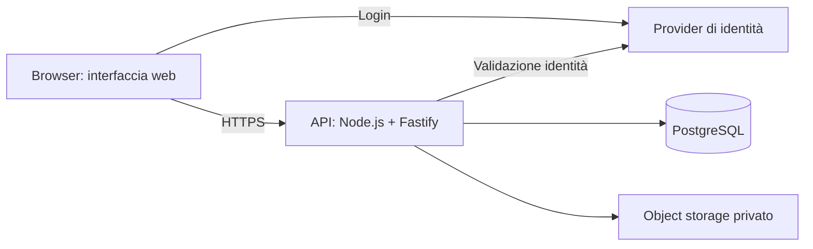

# Architettura proposta — web app multiutente

Stato: architettura proposta con Railway scelto come piattaforma per l'ambiente di prova. È disponibile uno [schema SQL d'ingestione generico con test sintetici](../database/README.md); backend, database remoto e nuovi moduli non sono ancora operativi. La demo esistente continua a usare localStorage. Nessun servizio provisionato o piano attivato.

## Modalità complementare

Il prodotto è destinato all'uso interno e affianca un sistema sorgente: legge export e file autorizzati, mantiene snapshot e aggiunge viste, annotazioni e aggiornamenti interni. Stati e dati ufficiali importati rimangono distinti dalle informazioni interne. Nessun aggiornamento automatico o chiusura di record nel sistema esterno è previsto. Vedere [Import e archivio documenti](import-storage.md).

## Scelta del database

**PostgreSQL relazionale** come archivio principale. Il prodotto ha entità con relazioni e regole consistenti: organizzazioni, cantieri, utenti, imprese, attività, deviazioni, milestone, avanzamento e diari. Chiavi esterne, vincoli, transazioni e query SQL aiutano a mantenere questi dati coerenti e a produrre report riproducibili.

Un database PostgreSQL condiviso con separazione logica per organizzazione e cantiere è il punto di partenza proposto. I moduli usano lo stesso modello di identità, aree, imprese e documenti; ciascuno possiede le proprie tabelle. Le capacità necessarie non richiedono database diversi per modulo.

| Tipo | Impiego proposto | Quando |
| --- | --- | --- |
| Relazionale SQL: PostgreSQL | Dati operativi, autorizzazioni, revisioni, storico e report | Prima versione multiutente |
| Object storage compatibile S3 | File binari: foto, PDF, disegni, allegati | Con il modulo documenti/allegati |
| JSONB dentro PostgreSQL | Metadati opzionali, mapping e payload originali degli import | Dove la variabilità dei dati lo richiede |
| IndexedDB nel browser | Coda locale delle operazioni e bozze offline | Dopo progettazione della sincronizzazione |
| SQLite | Strumento utile per applicazioni locali o singolo dispositivo | Alternativa per un prodotto locale; PostgreSQL resta la scelta per questa web app |
| Database documentale NoSQL | Documenti con struttura molto variabile e accessi centrati sul documento | Non selezionato per il nucleo operativo, che richiede molte relazioni e vincoli |

JSONB integra il modello relazionale: campi interrogati spesso, assegnazioni, date, stati e quantità rimangono colonne con tipi e vincoli. I file restano nell'object storage; PostgreSQL conserva identificativo del file, chiave di storage, versione, tipo, dimensione, checksum e collegamenti autorizzati.

## Stack consigliato

| Livello | Tecnologia | Responsabilità |
| --- | --- | --- |
| Interfaccia | HTML/CSS e moduli JavaScript esistenti per la prima demo; React + TypeScript + Vite come evoluzione da motivare | Schermate, form, IT/EN, visualizzazione e gestione dello stato client; riuso iniziale per contenere il lavoro |
| Backend | Node.js LTS + TypeScript + Fastify | API, autorizzazioni, validazione, transazioni, import ed export |
| Accesso dati | Prisma, con migrazioni SQL dove servono vincoli specifici | Modello tipizzato, query e versionamento dello schema |
| Database | PostgreSQL su una major supportata dal provider | Persistenza e vincoli; stessa major in sviluppo, test e produzione |
| Identità | Provider OIDC gestito, da scegliere | Login, recupero account e gestione dell'identità; ruoli applicativi nel backend |
| File | Archivio privato compatibile S3; SDK nel backend, MCP opzionale | File e versioni autorizzati; riferimenti in PostgreSQL; credenziali soltanto server |
| Verifiche | Test di dominio, integrazione su PostgreSQL reale, Playwright | Regole, permessi, concorrenza e flussi browser |

La scelta della versione Node viene fissata all'avvio del backend su una LTS supportata dagli strumenti selezionati. Frontend e API restano due componenti di un'unica applicazione, con moduli interni. Questa struttura permette di crescere per funzionalità senza introdurre subito servizi indipendenti.

Il browser comunica con l'API, che controlla identità, cantiere, ruolo e modulo prima di ogni operazione. Credenziali del database e chiavi di storage restano sul server. L'interfaccia può nascondere azioni non disponibili, ma la decisione vincolante avviene nel backend.

## Moduli e dipendenze

Una base condivisa contiene organizzazioni, cantieri, utenti, imprese, aree/asset, file e registro eventi. I moduli vengono abilitati per cantiere tramite configurazione server, con stato e dipendenze espliciti.

| Fase | Modulo | Dipendenze principali |
| --- | --- | --- |
| 1 | Attività e coordinamento | Base condivisa |
| 1 | Qualità e deviazioni | Base condivisa; collegamento facoltativo alle attività |
| 1 | Pianificazione, layout e mappe | Import Excel, Gantt/WBS, avanzamento per percentuale/quantità/azione sì-no; PDF e immagini revisionati. CAD originale con anteprima; conversioni avanzate successive |
| 1 | Diario e turni | Base condivisa; riferimenti alle attività e all'avanzamento |
| 1 | Documenti, storico e dashboard | Servizi condivisi; viste derivate dai moduli attivi |
| 2 | Logistica di cantiere | Materiali, ubicazioni, ricevimenti e movimenti |
| 2 | Engineering | Distinte, componenti e revisioni dei disegni |
| Successiva | Acquisti, produzione e personale | Perimetro e integrazioni da concordare |

Disabilitare un modulo non cancella i dati: la configurazione distingue accesso in lettura, scrittura e archiviazione. Le API verificano le dipendenze; i report segnalano moduli esclusi o dati non disponibili. I ruoli utente e l'abilitazione dei moduli sono controlli distinti.

## Modello dati iniziale

| Gruppo | Entità proposte | Regole principali |
| --- | --- | --- |
| Identità e contesto | organizations, users, organization_memberships, sites, site_memberships | Utenti associati a organizzazioni e cantieri con permessi espliciti |
| Imprese e localizzazione | companies, site_companies, areas, assets | Imprese riutilizzabili; aree e asset appartenenti a un cantiere |
| Configurazione | site_modules | Codice modulo, modalità di accesso e dipendenze soddisfatte |
| Lavoro | work_packages, tasks, task_events | Esecutore, responsabile e verificatore distinti; ogni transizione conservata |
| Qualità | deviations, deviation_events, verifications, task_deviations | Problema distinto dal lavoro correttivo; una deviazione può richiedere più attività |
| Pianificazione | schedules, schedule_revisions, schedule_items, schedule_item_revisions, schedule_dependencies, milestones, progress_items, progress_entries, progress_verifications | Baseline e piano corrente distinti; misura per percentuale, quantità o azione sì/no; dichiarato e verificato; origine e data del dato |
| Layout e mappe | layouts, layout_revisions, document_derivatives, map_annotations e collegamenti tipizzati | Originali e anteprime separati; coordinate e annotazioni associate alla revisione; collegamenti ad aree, asset, attività e deviazioni |
| Diario | daily_reports, report_revisions, shifts, diary_entries | Un diario per cantiere/giorno operativo; contributi per turno; rettifiche tracciate |
| Documenti | documents, document_versions, task_documents, deviation_documents, report_documents | Collegamenti tipizzati con chiavi esterne e appartenenza allo stesso cantiere |
| Tracciabilità e import | audit_events, source_connections, import_profiles, import_profile_versions, import_batches, import_files, external_records, external_record_snapshots, reconciliation_items | Snapshot esterni immutabili e aggiornamenti interni separati; mapping versionato; import idempotenti; fonte e data del dato |

### Distinzione tra attività, deviazione e avanzamento

- **Attività:** lavoro assegnato a qualcuno, con scadenza e risultato atteso.
- **Deviazione:** problema rilevato, con classificazione, gravità, criterio di risoluzione e verifica. Può generare attività correttive mantenendo una propria identità.
- **Voce di avanzamento:** risultato misurabile relativo a un pacchetto di lavoro, per esempio quantità pianificata e verificata con unità di misura.

Una card chiusa non determina automaticamente una percentuale di avanzamento. Per aggregare l'avanzamento servono unità o pesi espliciti; le righe prive di una base di misura restano separate. Previsioni, baseline e consuntivi hanno revisioni e significati distinti.

La [specifica Pianificazione, layout e mappe](planning-layouts.md) dettaglia gli input Excel, PDF, immagini ad alta risoluzione e CAD, i metodi di avanzamento e le regole di versionamento. La conservazione di un CAD e la sua visualizzazione nativa sono capacità distinte; conversioni e risorse richiedono verifica prima dell'implementazione.

La demo attuale usa un unico oggetto per attività e relativa verifica: l'introduzione delle entità separate richiederà una migrazione esplicita, senza dedurre automaticamente deviazioni da titoli o descrizioni.

## Vincoli e transazioni

- UUID per gli identificativi; codice cantiere univoco nell'organizzazione.
- Foreign key composite con organizzazione/cantiere per impedire collegamenti tra contesti diversi; indici coerenti con le query per cantiere, stato, responsabile e data.
- Identità del provider associata a un utente interno; autenticazione distinta da autorizzazione.
- `DATE` per giorno operativo e scadenze giornaliere; `TIMESTAMPTZ` per eventi e intervalli dei turni; fuso IANA configurato sul cantiere. Lingua dell'interfaccia indipendente dal fuso.
- Quantità e pesi in `NUMERIC` con unità esplicita; definizione del metodo di aggregazione prima di produrre indicatori.
- Proposta di completamento, verifica e storico aggiornati in una transazione; chiusura consentita al verificatore autorizzato, diverso dall'esecutore, secondo la policy concordata.
- Colonna `version` per aggiornamenti concorrenti: modifica con versione superata respinta e presentata all'utente per riconciliazione.
- Unicità diario per cantiere e giorno operativo; più turni e contributi; chiusura e rettifiche con revisioni conservate.
- Eventi di dominio e audit aggiunti alle operazioni, protetti dai normali permessi di modifica. Stato corrente interrogabile senza dover ricostruire ogni lettura dall'intera sequenza di eventi.
- Archiviazione del cantiere conservando lo storico; politiche di conservazione e cancellazione definitiva da definire prima dell'uso operativo.
- Dashboard ottenute da query/viste sui dati. Eventuali aggregazioni persistenti richiedono invalidazione e data di aggiornamento visibile.

L'API applica autorizzazioni per organizzazione/cantiere a ogni lettura, scrittura, esportazione e download. PostgreSQL Row-Level Security può aggiungere protezione con contesto transazionale per richiesta; richiede policy, gestione del connection pool e test dedicati, e non sostituisce i controlli del backend.

## Hosting e gestione

Piattaforma scelta per la demo: **Railway**, per centralizzare esecuzione dell'applicazione, PostgreSQL e collegamento al repository GitHub. L'obiettivo è ridurre il numero di fornitori dell'ambiente di prova mantenendo l'interfaccia esistente. Costi ricorrenti e costi di sviluppo sono distinti. Vedere [Valutazione economica](cost-options.md).

### Assetto previsto su Railway

- Un progetto con un ambiente di prova iniziale e due servizi: applicazione e PostgreSQL.
- Il servizio applicazione esegue l'API Node.js e serve anche il frontend statico, con un solo indirizzo HTTPS pubblico.
- PostgreSQL usa storage persistente e un collegamento privato dall'applicazione; credenziali tramite variabili di riferimento della piattaforma, mai nel repository o nel browser.
- Il repository GitHub è la sorgente del codice. Branch di deploy, controlli e attivazione degli aggiornamenti automatici vanno verificati prima della prima pubblicazione.
- Il server rispetta la porta assegnata dalla piattaforma e ascolta sull'interfaccia richiesta dal runtime. Health check e verifica di disponibilità del database hanno endpoint distinti e non espongono dati applicativi.
- Migrazioni versionate eseguite come passaggio controllato prima della nuova versione, con strategia per evitare esecuzioni concorrenti. Il popolamento dimostrativo è esplicito e idempotente.
- Selezionare una regione europea disponibile e verificare versione PostgreSQL, quote, volumi, backup e ripristino nel piano effettivo. Ospitare il database sulla piattaforma non dimostra che ogni attività di amministrazione o recupero sia inclusa.
- Per i file integrare un archivio S3 compatibile configurato privatamente, con accesso iniziale in sola lettura agli oggetti selezionati. Metadati, import e relazioni restano in PostgreSQL; permessi di scrittura per output/derivati sono separati e da definire.

Il primo ambiente resta destinato a dati sintetici. Lo sviluppo locale rimane separato; un futuro ambiente di produzione avrà dati, credenziali e risorse distinti. Non si assume che il collegamento GitHub o il progetto Railway siano già stati verificati da questa sessione.

Il riuso di server condivisi con altri carichi è escluso dal perimetro corrente; non è previsto alcun controllo, collegamento o deploy su tali sistemi.

Sviluppo, staging e produzione hanno database, credenziali e bucket separati. Le migrazioni fanno parte del repository; i valori dei segreti sono configurati nel servizio di hosting. Il ripristino deve coprire anche file e revisioni, non soltanto le tabelle SQL. I dati dimostrativi e le fixture sono sintetici.

## Passaggio dalla demo al pilota

1. Consolidare entità, ruoli e flussi delle macroaree della prima fase.
2. Preparare schema PostgreSQL, migrazioni, dati sintetici e test dei vincoli.
3. Introdurre API, login e autorizzazioni; collegare l'interfaccia mantenendo i flussi discussi.
4. Aggiungere deviazioni distinte, pianificazione/avanzamento e diario revisionato per incrementi verificabili.
5. Integrare un primo profilo di export e l'accesso S3 in sola lettura, con campioni di sviluppo sintetici. Aggiungere report e verificare backup/restore in staging.
6. Importare eventuali backup locali soltanto con anteprima, mapping e conferma, assegnando il cantiere e sostituendo le identità simulate con utenti autorizzati. Nessun caricamento automatico nel nuovo backend.
7. Eseguire il pilota prima delle estensioni logistiche e delle integrazioni.

Da decidere prima del provisioning: utenti e cantieri concorrenti, volume allegati, necessità offline, budget, regione e responsabilità operative. Queste informazioni influenzano dimensionamento e fornitore, senza impedire la scelta del modello relazionale e lo sviluppo del nucleo applicativo.
